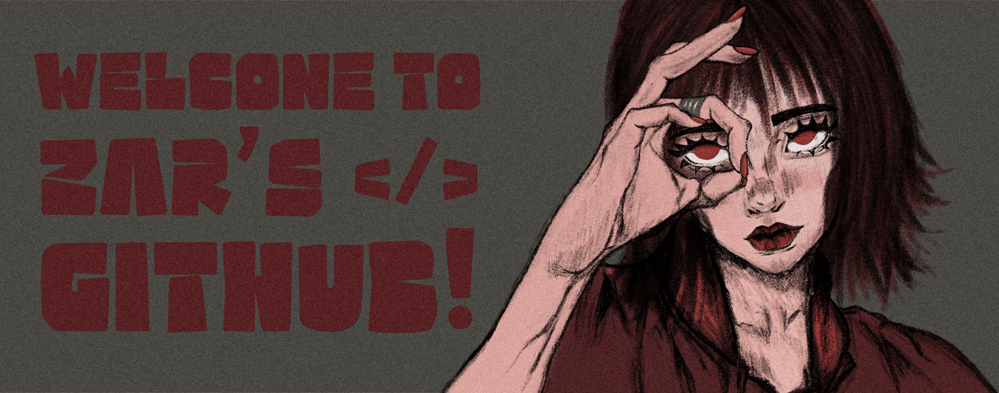
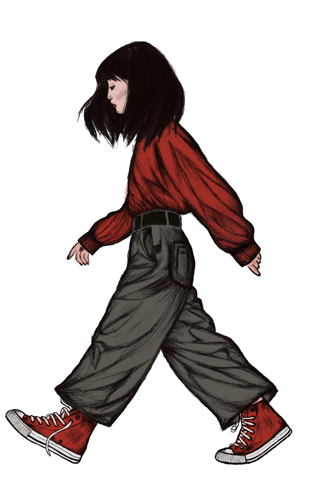

<div align="center">



<br/>


<br/>

[](https://t.me/zar_ghn1)
[](https://www.linkedin.com/in/zarghn)
[](https://www.tiktok.com/@zar_ghn)
[](https://www.pinterest.com/YOUR-PINTEREST)

</div>

<br/>

## `01` &nbsp;/&nbsp; BOOT SEQUENCE

```bash
$ whoami
> zahra qorbany — a designer who ships code

$ cat ./origin
> graphic design  →  front-end engineering

$ cat ./now.json
{
  "learning":  ["TypeScript", "Next.js"],
  "obsessed":  ["spacing", "type", "tiny interactions"],
  "based_in":  "Iran",
  "status":    "open to interesting work"
}

$ ./start --mode=creative
[ OK ] sketchbook loaded
[ OK ] design system mounted
[ OK ] coffee level: critical
[ OK ] bugs converted to features
```

---

## `02` &nbsp;/&nbsp; THE SPLIT

<table>
<tr>
<td width="34%" valign="top" align="right">

<h4>THE DESIGNER</h4>
<sub>
grid & rhythm<br/>
type with attitude<br/>
color with intent<br/>
pencil → pixels<br/>
</sub>

</td>
<td width="32%" align="center" valign="middle">



</td>
<td width="34%" valign="top" align="left">

<h4>THE DEVELOPER</h4>
<sub>
components that scale<br/>
clean, readable code<br/>
performance that matters<br/>
pixels → production<br/>
</sub>

</td>
</tr>
</table>

<div align="center"><sub>one brain · two hemispheres · zero handoff friction</sub></div>

---

## `03` &nbsp;/&nbsp; MANIFESTO

```diff
- templates
- copy-paste components
- default blue buttons
- "good enough" spacing
+ interfaces drawn before they're coded
+ every pixel has a reason
+ design and code that respect each other
+ things that look good AND work well
```

---

## `04` &nbsp;/&nbsp; PIPELINE

<div align="center">


</div>

---

## `05` &nbsp;/&nbsp; LOADOUT

<table>
<tr>
<td width="140"><sub><b>INTERFACE</b></sub></td>
<td>


</td>
</tr>
<tr>
<td><sub><b>LANGUAGES</b></sub></td>
<td>


</td>
</tr>
<tr>
<td><sub><b>DESIGN</b></sub></td>
<td>


</td>
</tr>
<tr>
<td><sub><b>WORKFLOW</b></sub></td>
<td>


</td>
</tr>
</table>

---

## `06` &nbsp;/&nbsp; SIGNAL

<div align="center">


<br/><br/>


</div>

---

<br/>

<div align="center">

> *Design is the silent ambassador of your code.*
>
> <sub>— Z. QORBANY</sub>

<br/>

```bash
$ echo "see you in the next commit"
> see you in the next commit
$ _
```

</div>
>
> <sub>— Z. QORBANY</sub>

<br/>

<sub>◼ &nbsp; built by hand, drawn by hand &nbsp; ◼</sub>

</div>
